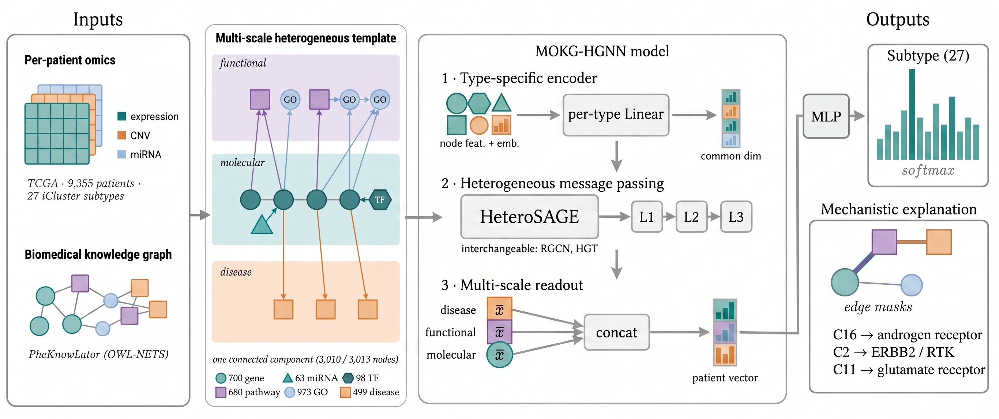

# MOKG-HGNN

**Multi-scale heterogeneous GNN for pan-cancer molecular subtyping, built on a biomedical knowledge graph.**

MOKG-HGNN classifies tumours into the 27 integrated iCluster subtypes by representing
each patient as a *heterogeneous graph* that links the molecular layer
(gene / miRNA / TF) upward through **pathway → Gene Ontology → disease** nodes taken from
the PheKnowLator knowledge graph (OWL-NETS). The task is graph classification, one graph
per patient: message passing reasons across several levels of biological organisation
rather than over molecular features alone.



---

## What is in here

- **Heterogeneous graph builder** producing a `HeteroData` template with six node types
  (`gene`, `miRNA`, `TF`, `pathway`, `GO_term`, `disease`) and typed relations
  (gene↔gene, miRNA→gene, TF→gene, gene→pathway, gene→GO, GO→GO, gene→disease, plus
  optional metapaths). Reverse relations are added for bidirectional message passing.
- **Three interchangeable heterogeneous backbones**: `rgcn` (one weight per relation),
  `hetero_sage` (SAGEConv per relation), `hgt` (attention per meta-relation). All share
  the same type-specific encoder and multi-scale readout.
- **Unified variance-based feature selection** over gene/TF/miRNA, computed on the
  training fold only.
- **Optuna tuning** (one study per backbone) and **multi-seed evaluation**.
- **Experiment drivers**: ablation, feature-collapse, per-class aggregation and
  GNNExplainer-based attribution.
- **Vendored baselines** under `benchmark/`, so comparisons run from a single checkout.

## Requirements

Conda and a CUDA GPU (tested on CUDA 12.8 / torch 2.7 / PyG 2.7). Everything runs through
`conda run`, so neither `make` nor `sudo` is required.

Raw and preprocessed data live in `data/` (gitignored). If absent, `prepare_data.sh`
regenerates everything end to end: it downloads the **PheKnowLator** tables
(`scripts/download_pkt.py`, ~290 MB) and the **TCGA Pan-Cancer omics**
(`scripts/download_pancan.py`), preprocesses them and builds the splits.

## Quick start

```bash
bash setup_env.sh        # 1. create the `gnn` env + pip install -e .
bash prepare_data.sh     # 2. data preprocessing (only if data/training/ is absent)
bash make_graph.sh       # 3. feature selection + graph template
bash train_and_eval.sh   # 4. training + evaluation
```

Each run writes `results/<experiment>/<timestamp>/` with `model_best.pt`, `run.log`,
`history.csv`, `metrics.json`, `per_class_metrics.csv`, `confusion_matrix.csv` and
`graph_info.json` (the node and edge types actually used, plus `has_metapath`).

### Multi-seed evaluation

```bash
BACKBONE=hetero_sage bash train_and_eval.sh --runs 5
```

Runs N independent splits (seeds 42, 43, …), rebuilding feature selection and template
from each split's training fold so that no test sample influences the graph, with the
model-initialisation seed held fixed. Prints mean ± s.d. of every metric.

### Choosing the backbone

```bash
BACKBONE=hetero_sage  bash train_and_eval.sh   # SAGEConv per relation
BACKBONE=rgcn         bash train_and_eval.sh   # one weight per relation
BACKBONE=hgt          bash train_and_eval.sh   # attention per meta-relation
```

Results go to separate folders (`results/kg_hgnn_<backbone>/`). Each backbone has its own
tuned configuration in `configs/config_kg_hgnn_<backbone>.yml`, since their optima differ.

### Metapaths

Co-target metapaths (two miRNAs or two TFs sharing a target gene) are **off by default**
and are decided at graph-construction time, not at runtime:

```bash
METAPATH=--metapath BACKBONE=hetero_sage bash train_and_eval.sh
```

> **Reproducibility caveat.** The template is always written to
> `data/prior_knowledge/hetero/hetero_graph_template.pt`. Rebuilding it with a different
> configuration at the same path overwrites it, and older checkpoints stop matching
> (edge-type mismatch). Use `--runs`, which saves one template per seed, or change
> `OUT_DIR`. To inspect which graph a run was trained on:
> `python scripts/kg_hgnn/which_graph.py`.

Other knobs (environment variables): `TOP_GENES` (default 700), `TOP_TF` (200),
`TOP_MIRNA` (100), `SEED`, `GO_MIN_SUPPORT` (3), `CONFIG`.

> **Note.** The number of molecular nodes is fixed when the **template is built**
> (`--top-genes` in `make_graph.sh`), not at runtime. Requested is not the same as
> present: a miRNA or TF enters the graph only if it links to a selected gene, so those
> panels shrink to the connected survivors.

## Tuning

One Optuna study per backbone; the objective is **validation** macro-F1, never test.
Tuning reuses the already-built template, so it inherits the metapath choice made in
`make_graph.sh`.

```bash
BACKBONE=hetero_sage bash tune.sh    # one backbone (default 35 trials)
bash tune_all.sh                     # all three in sequence
```

Output goes to `results/optuna/kg_hgnn_optuna_<backbone>/best.json` plus a CSV report.
Copy the winning parameters into `configs/config_kg_hgnn_<backbone>.yml` and re-run with
`--runs`.

`readout_types` is deliberately **excluded from the search** and held complete: which
scales enter the readout is an experimental factor, studied by the ablation, so it is
fixed by design rather than optimised.

## Experiments

### Ablation

Removes one factor at a time from the full configuration, rebuilding the template only
for the axes that change the graph and reusing it for config-only axes.

```bash
bash ablation.sh                                   # all 9 variants, 5 seeds
VARIANTS="full no_pathway no_go" bash ablation.sh  # subset
```

Variants: `full` · `no_metapath` · `no_disease` · `no_pathway` · `no_go` · `readout_mol` ·
`readout_pathway` · `no_cnv` · `no_mirna`. Aggregation and paired statistics
(Friedman omnibus, Holm-corrected Wilcoxon):

```bash
python scripts/kg_hgnn/ablation_aggregate.py --results results/ablation_hetero_sage
python scripts/kg_hgnn/ablation_stats.py     --results results/ablation_hetero_sage
```

### Feature collapse

Runs both models over a decreasing gene grid, to compare how fast each degrades as the
molecular panel shrinks.

```bash
MODELS="mokghgnn mognntf" bash run_feature_collapse.sh
```

The comparison is only meaningful if both models see the *same* features:
`scripts/collapse_mognntf.py` forces the molecular baseline onto the identical surviving
panel at each level (same genes, same miRNA and TF, by name), derived with
`scripts/kg_hgnn/survived_features.py`. Re-aggregate without retraining:

```bash
python scripts/kg_hgnn/collapse_aggregate.py --results results/feature_collapse
```

### Per-class performance

Every run already saves `per_class_metrics.csv` and `confusion_matrix.csv`; the experiment
is the multi-seed aggregation and side-by-side comparison against the molecular baseline.

```bash
bash experiments.sh per_class
```

Recompute per-class files for **old** runs from the checkpoint, without retraining:

```bash
python scripts/kg_hgnn/eval_per_class.py --all
```

### Explainability

Mechanism-level attribution: which `pathway` and `GO_term` nodes drive the prediction for
each subtype. Because those nodes carry no features, attribution uses GNNExplainer **edge
masks**, averaged per node and normalised by degree so that high-degree hubs cannot
dominate, then reported as a *distinctive score* (a subtype's importance minus the
across-class mean).

```bash
python scripts/kg_hgnn/explain.py --run results/<experiment>/<timestamp> --per-class 15 --epochs 50
```

Writes `top_pathway_by_subtype.csv` and `top_GO_term_by_subtype.csv` with real Reactome
and GO identifiers, plus subtype × mechanism heatmaps. Human-readable names are resolved
from the source knowledge graph; regenerate the lookup tables with
`python scripts/kg_hgnn/extract_pkt_names.py`.

## Repository layout

```
src/multiomics_kg_hgnn/      # model package: encoder, backbones, readout, training loop
scripts/kg_hgnn/             # entrypoints: train, evaluate, run_optuna, explain, aggregators
scripts/preprocessing/       # omics and prior-knowledge preprocessing, build_hetero_graph.py
configs/                     # config_kg_hgnn*.yml, best_model_config*.yml
benchmark/                   # vendored baselines
figures/                     # figures used in this README
*.sh                         # launchers
```

## Configuration

`configs/config_kg_hgnn.yml` drives a run: `data.split_dir`, `data.template_path`,
ablation switches (`use_cnv`, `use_mirna`), `model.backbone` / `hidden` / `num_layers` /
`heads` / `dropout` / `readout_types` (multi-scale pooling), `scheduler`, early stopping
and class-imbalance handling (`class_weighted_loss`, `sampler_strategy`).

## Baselines

[`benchmark/`](benchmark/) vendors the baseline implementations **unmodified** and under
their original licenses, so comparisons can be reproduced from this repository; copyright
remains with the original authors. See [`benchmark/README.md`](benchmark/README.md).

**MOGNN-TF**, our previous single-scale molecular model, is used as the reference
baseline and is archived on Zenodo:

> De Filippis, G. M., Rinaldi, A. M., Tommasino, C. *MOGNN-TF: code and supplementary
> material*. Zenodo. https://doi.org/10.5281/zenodo.21475911

The MOKG-HGNN framework does not depend on it.

## Data

All input data are public. Gene expression, gene-level copy number and miRNA expression
for the TCGA Pan-Cancer cohort come from the UCSC Xena hub; labels are the integrated
iCluster taxonomy of Hoadley et al. Note that the label space runs C1–C28 with **C24
(LAML) absent**, giving 27 classes with a gap at C24.

The knowledge graph is obtained from an archived property-graph release:
https://doi.org/10.5281/zenodo.21629419

## Citation

A manuscript describing this model is under review; citation details will be added here
once available. In the meantime, please cite this software release.

## License

See [LICENSE](LICENSE). Vendored baselines under `benchmark/` keep the licenses of their
original authors.
